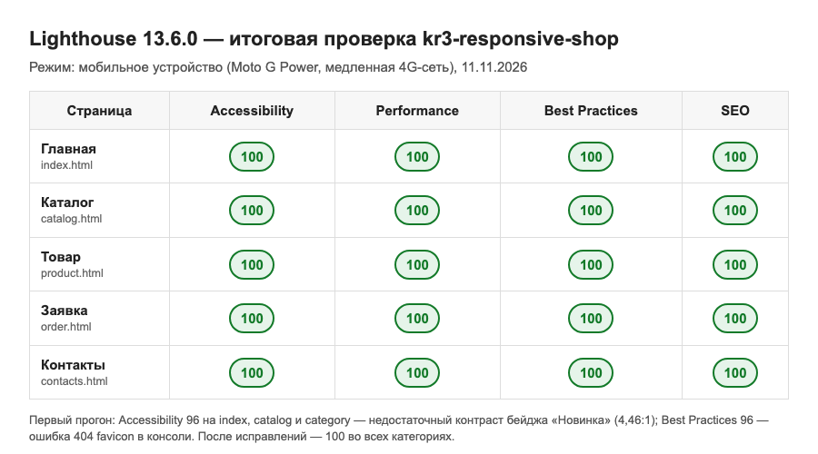
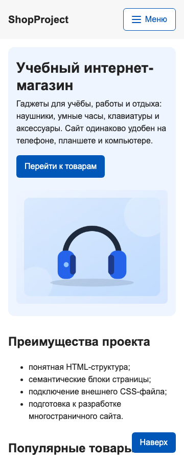
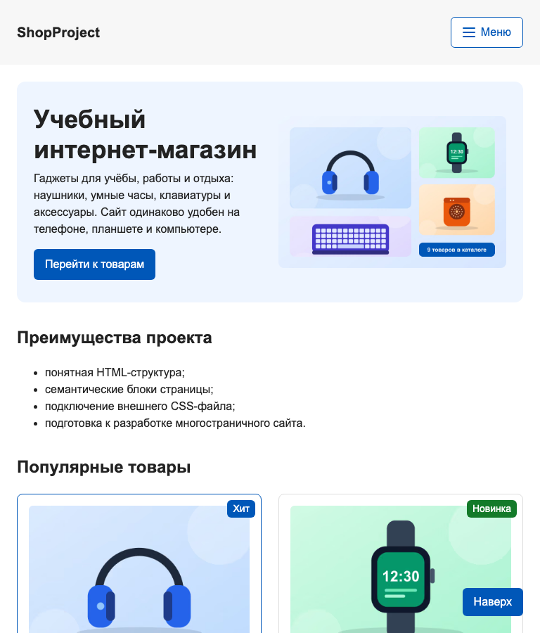
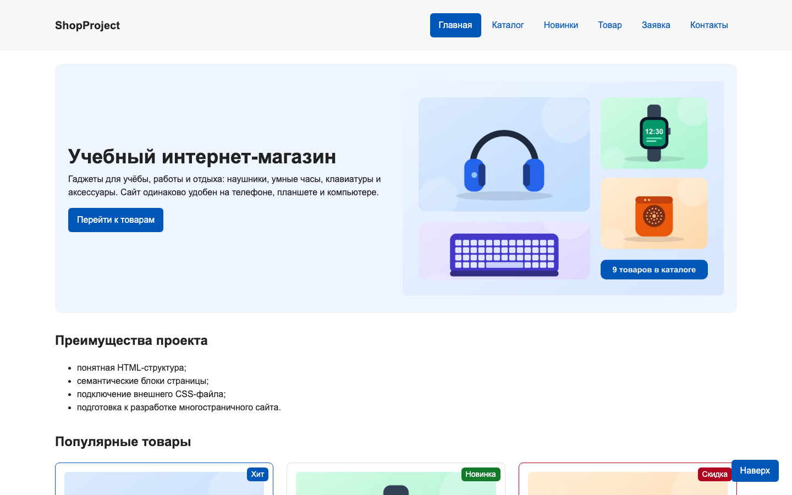

# kr3-responsive-shop — адаптивный учебный интернет-магазин

Многостраничный HTML/CSS-сайт интернет-магазина из контрольной работы №1,
адаптированный под экраны от 360 до 1440 px и проверенный на доступность.
Дисциплина «Фронтенд и бэкенд разработка».

## Контрольная работа №3

Тема: «Адаптивная вёрстка и доступность многостраничного HTML/CSS-сайта».

## Описание проекта

Основа — проект КР №1 ([gothplug/kr1_front](https://github.com/gothplug/kr1_front)):
та же структура страниц, БЭМ-классы и файл `css/style.css`. Bootstrap и другие
CSS-фреймворки не используются — адаптивность сделана вручную через медиазапросы,
Flexbox, CSS Grid и `<picture>`.

Первый коммит репозитория — перенос КР №1 без изменений, поэтому все правки КР №3
видны в истории коммитов.

## Опубликованная версия

GitHub Pages: https://gothplug.github.io/kr3-responsive-shop/

Репозиторий: https://github.com/gothplug/kr3-responsive-shop

## Структура проекта

```
kr3-responsive-shop/
├── index.html            главная: hero, преимущества, популярные товары, отзывы, FAQ, модальное окно
├── catalog.html          каталог: фильтр, навигация по категориям, сетка карточек
├── category.html         категория «Новинки» (дополнительная страница из КР №1)
├── product.html          товар: фото, описание, таблицы характеристик и тарифов доставки
├── order.html            форма заявки
├── contacts.html         контакты и форма обратной связи
├── css/
│   ├── style.css         базовые стили (рассчитаны на телефон)
│   └── responsive.css    адаптивные стили: медиазапросы min-width
├── js/
│   └── main.js           мобильное меню, модальное окно, фильтр каталога, проверка форм
├── images/
│   ├── products/         товары: 3 ширины × 3 формата (AVIF, WebP, JPG)
│   ├── hero/             два кадра hero-блока: для телефона и для desktop
│   ├── favicon.svg
│   └── og-preview.jpg    превью для соцсетей (Open Graph)
├── lighthouse/
│   ├── accessibility-report.png    скриншот отчёта Accessibility (главная)
│   ├── accessibility-report.html   полный отчёт Accessibility (главная)
│   ├── summary.png                 итоговые баллы всех страниц
│   └── *-report.html               полные отчёты по 5 страницам (4 категории)
├── screenshots/          скриншоты страниц на проверенных ширинах
├── sitemap.xml
├── README.md
└── .gitignore
```

## Подключение стилей

На каждой странице:

```html
<meta name="viewport" content="width=device-width, initial-scale=1.0">
...
<link rel="stylesheet" href="css/style.css">
<link rel="stylesheet" href="css/responsive.css">
<script src="js/main.js" defer></script>
```

`responsive.css` подключается после `style.css`, чтобы адаптивные правила могли
переопределять базовые.

## Адаптивные решения

### Подход Mobile First

- Базовые стили в `style.css` описывают **телефонную** версию: одна колонка,
  отступы 16 px, меню свёрнуто.
- В `responsive.css` только медиазапросы с `min-width` — по мере роста экрана
  добавляются колонки и отступы.
- Старые медиазапросы КР №1 с `max-width` удалены.

| Точка | Что меняется |
|---|---|
| базовые стили | одна колонка, меню под кнопкой, фильтр свёрнут, таблицы — карточками |
| `min-width: 600px` | карточки товаров и отзывы по 2 в ряд; таблицы снова таблицы в `.table-wrapper`; открытый фильтр в 2 колонки |
| `min-width: 768px` | отступы 24 px; hero и страница товара в 2 колонки; формы в 2 колонки; контакты в 3 колонки; подвал в строку |
| `min-width: 1024px` | меню в строку без кнопки; каталог: фильтр слева (260 px, sticky) + товары; карточки по 3 в ряд |
| `min-width: 1440px` | контейнер расширяется с 1100 до 1240 px |

### Что адаптировано

- **Viewport** — есть на всех страницах; `meta charset` перенесён в начало `<head>`.
- **Навигация** — до 1024 px меню прячется под кнопку «Меню»; кнопка меняет
  `aria-expanded`, иконка превращается в крестик, Esc закрывает меню и возвращает
  фокус. Без JavaScript меню просто показывается списком.
- **Hero-блок** — Flexbox: текст над картинкой на телефоне, рядом с 768 px.
- **Сетка карточек** — CSS Grid: 1 → 2 (600 px) → 3 (1024 px) колонки.
- **Каталог и фильтр** — Grid-раскладка; на телефоне фильтр свёрнут под кнопку
  «Показать фильтры», на планшете поля в 2 колонки, на desktop — липкая боковая колонка.
- **Страница товара** — фото и описание в одну или две колонки.
- **Таблицы** — обёрнуты в `.table-wrapper` с `overflow-x: auto` и `min-width: 640px`:
  прокручивается только таблица, не страница. На экранах уже 600 px каждая строка
  показывается карточкой.
- **Формы** — одна колонка на телефоне, две с 768 px; поля и кнопки не ниже 44 px,
  кнопки не слипаются (`gap`).
- **Длинные слова** — `overflow-wrap: break-word` на `body`.
- **Модальное окно** — ширина `min(100% - 32px, 560px)`, высота не больше экрана,
  прокрутка внутри.

### Responsive images

- Общее правило в `responsive.css`: `img, video { max-width: 100%; height: auto; }`.
- **Карточки и страница товара** — `<picture>` с `srcset` и `sizes`:
  - 3 ширины: 400, 800, 1200 px;
  - 3 формата: AVIF → WebP → JPG (браузер берёт первый, который поддерживает).
- **Hero** — art direction через `<picture>` и `<source media="(min-width: 768px)">`:
  - на телефоне крупный кадр 4:3 с одним товаром;
  - на desktop широкий кадр 3:2 с несколькими товарами.
- У всех картинок заданы `width` и `height`, чтобы страница не прыгала при загрузке.
  У изображений ниже первого экрана есть `loading="lazy"`, у главной картинки
  страницы — `fetchpriority="high"`.

Как проверить: DevTools → Network → фильтр Img. На ширине 360 px загружается
`hero-mobile-*.avif`, на 1440 px — `hero-desktop-1440.avif`.

## Доступность

- Ссылка «Перейти к основному содержимому» — первый элемент при нажатии Tab.
- Единый заметный фокус `:focus-visible` (рамка 3 px) у всех ссылок, кнопок и полей.
- **Контраст** — Lighthouse нашёл недостаточный контраст бейджа «Новинка»
  (белый на `#168a2f` — 4,46:1). Цвет затемнён до `#137a29` — 5,46:1.
- У всех полей форм есть `label`; ошибки отмечаются `aria-invalid`, фокус
  переходит на первое ошибочное поле.
- У всех изображений осмысленный `alt` (что изображено, а не «Товар 1»).
- На каждой странице один `h1`, заголовки по порядку, навигация в `<nav>`
  с `aria-label`, текущая страница отмечена `aria-current="page"`.
- Ссылки «Подробнее» дополнены скрытым текстом с названием товара для экранного диктора.
- Модальное окно на `<dialog>`: фокус в первое поле, Esc закрывает, после закрытия
  фокус возвращается на кнопку «Заказать».
- Таблицы, которые на телефоне показываются карточками, сохраняют табличную
  семантику через `role` (ARIA добавлена только здесь, где без неё нельзя).
- Сообщения «Показано товаров», «Заявка отправлена» — `role="status"`, их зачитывает
  экранный диктор.
- `prefers-reduced-motion` — анимации и плавная прокрутка отключаются, если
  пользователь выбрал это в системе.

## Lighthouse

Проверка: Lighthouse 13.6.0, режим «мобильное устройство», страницы index, catalog,
product, order, contacts. Отчёты сохранены в папке `lighthouse/`.

| Проверка | Accessibility | Best Practices | Найдено |
|---|---|---|---|
| Первый прогон | 96 (index, catalog, category), 100 (остальные) | 96 | контраст бейджа «Новинка»; ошибка 404 favicon в консоли |
| После исправлений | **100** на всех страницах | **100** | — |

Performance и SEO — 100 на всех проверенных страницах.



Lighthouse не заменяет ручную проверку — он не проверяет порядок фокуса,
понятность текстов и удобство на реальном телефоне. Поэтому дополнительно
вручную проверены: проход по сайту клавишей Tab, меню и модальное окно
с клавиатуры, все страницы на 5 ширинах.

## Проверенные ширины

| Ширина | Устройство | Результат |
|---|---|---|
| 360 px | телефон | меню под кнопкой, одна колонка, таблицы карточками, нет горизонтального скролла |
| 430 px | крупный телефон | то же, карточки шире |
| 768 px | планшет | hero и формы в 2 колонки, карточки по 2, контакты по 3 |
| 1024 px | небольшой desktop | меню в строку, фильтр слева, карточки по 3 |
| 1440 px | широкий desktop | контейнер 1240 px |

На каждой ширине проверены все 6 страниц: шапка, навигация, hero, сетка карточек,
фильтр, страница товара, таблицы, формы, контакты, подвал, модальное окно.
Скрипт в DevTools проверял, что `scrollWidth` страницы равен ширине окна.
Скриншоты — в папке `screenshots/`.

| 360 px | 768 px | 1440 px |
|---|---|---|
|  |  |  |

## Самостоятельные доработки

1. **Мобильное меню с полным сценарием**:
   - иконка-«бургер» превращается в крестик, текст кнопки «Меню» / «Закрыть»;
   - при открытии фокус переходит на первый пункт, Esc закрывает меню;
   - меню сбрасывается при растягивании окна до desktop;
   - без JavaScript меню остаётся обычным списком.
2. **Каталог сверх базового варианта**:
   - фильтр по категории и цене действительно отбирает карточки;
   - счётчик «Показано товаров», сообщение «товаров нет», кнопка «Сбросить»;
   - три раскладки фильтра: свёрнутый на телефоне, двухколоночный на планшете, липкая колонка на desktop.
3. **Карточное представление таблиц** на телефоне — вместо горизонтальной прокрутки:
   - характеристики показываются парами «название — значение»;
   - тарифы — карточками с подписями из `data-label`.
4. **Несколько вариантов responsive images**:
   - форматы AVIF/WebP/JPG;
   - 3 ширины на каждый товар;
   - разные кадры hero для телефона и desktop (art direction).
5. **Улучшенная доступность**: skip-link, единый фокус, исправленный контраст,
   доступное модальное окно с возвратом фокуса, уточнённые ссылки, reduced motion.
6. **Страница контактов** получила адаптивные карточки и форму обратной связи
   с проверкой полей.
7. **Настоящие товары** вместо заглушек «Товар 1–9»: названия, цены и иллюстрации.
   Нужно для осмысленных `alt` и демонстрации responsive images.
8. **Lighthouse 100** во всех четырёх категориях на всех проверенных страницах.
9. Публикация на **GitHub Pages**, облегчённое превью Open Graph (30 КБ вместо 2,3 МБ).

## Как проверить проект

1. Открыть https://gothplug.github.io/kr3-responsive-shop/, в DevTools включить режим
   устройства (Ctrl+Shift+M) и задать ширины 360, 430, 768, 1024, 1440.
2. На узком экране нажать «Меню»: список раскрывается, Esc закрывает.
3. На главной нажать «Заказать»: открывается окно с выбранным товаром; после
   закрытия фокус возвращается на кнопку.
4. В каталоге нажать «Показать фильтры», отметить «Новинки», задать цену — список
   и счётчик обновляются.
5. На странице товара на 360 px таблицы — карточками, на 600 px — таблица
   прокручивается внутри рамки.
6. На странице заявки отправить пустую форму — поля подсвечиваются, фокус на первом.
7. Нажать Tab в начале любой страницы — появляется ссылка «Перейти к основному содержимому».
8. Открыть отчёты в папке `lighthouse/`.

## Локальный запуск

```bash
git clone https://github.com/gothplug/kr3-responsive-shop.git
cd kr3-responsive-shop
python3 -m http.server 8000
```

Затем открыть http://localhost:8000.

## Автор

ФИО: Попов Илья Сергеевич
Группа: ЭФБО-06-25
